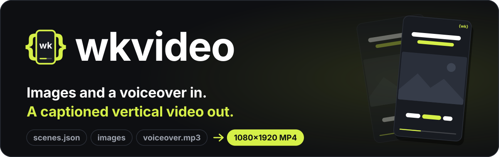
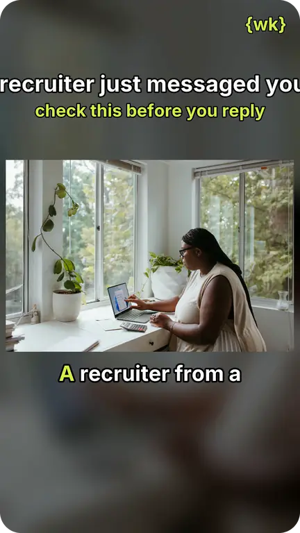

<p align="center">
  
</p>

<p align="center">
  
  <a href="LICENSE"></a>
  <a href="https://github.com/wkalidev/wkvideo/actions/workflows/tests.yml"></a>
  
</p>

<p align="center">
  
  <br>
  <sub>The first 4 seconds of a real render. Photo: <a href="https://unsplash.com/photos/YzLMmxDTrvI">Windows on Unsplash</a></sub>
</p>

```bash
pip install git+https://github.com/wkalidev/wkvideo.git
```

Turn a folder of images, an MP3 voiceover and a `scenes.json` into a vertical
**1080×1920 MP4** for Shorts, Reels and TikTok, with word-by-word captions.
Rendering and transcription run on your machine, with no cloud API.

Each scene is rendered as:

- a blurred, darkened copy of the image filling the background
- the image fitted to 96% of the width, with its top edge at 30% of the height
- the top text in white Inter Bold with a black stroke
- an accent line in lime `#D6F048`
- a lime `{wk}` logo in the top-right corner

Every frame is upscaled to 2160×3840, then run through an ffmpeg `zoompan`
slow zoom from 1.00 to 1.04 at 30 fps (upscaling first keeps the zoom from
jittering). The first scene opens with a hook punch: its top text
pops in, scaling from 1.3× to 1.0× over 0.25s, and the image zooms in fast
(1.00 to 1.06 over the first 0.6s, easing out) before the usual slow +0.04 zoom.
The headline zooms along with the image, and the `{wk}` logo stays still. The clips are encoded with libx264 and concatenated, and the MP3
is muxed in as AAC.

## Requirements

- Python 3.9+
- [ffmpeg](https://ffmpeg.org/) and ffprobe on your `PATH` (built with libx264)

## Install

```bash
pip install git+https://github.com/wkalidev/wkvideo.git
# or, from a clone:
pip install -e ".[test]"
```

## Usage

```
my-video/
├── scenes.json
├── voiceover.mp3
├── 01.jpg
└── 02.png
```

```bash
wkvideo my-video                 # writes my-video/output.mp4
wkvideo my-video -o final.mp4 --durations my-video/durations.json
python -m wkvideo my-video       # same thing, without installing the script
```

| Option | Description |
| --- | --- |
| `-o, --output` | Output MP4. Default: `FOLDER/output.mp4` |
| `--scenes` | Scenes file. Default: `FOLDER/scenes.json` |
| `--audio` | Voiceover MP3. Default: the only `.mp3` in the folder |
| `--durations` | JSON file of per-line durations. Overrides the scene durations |
| `--font` | Font file to use instead of the bundled Inter Bold |
| `--captions on\|off` | Word-by-word captions. Default: `on` |
| `--whisper-model` | faster-whisper model used for captions. Default: `small` |
| `--music PATH` | Background music mixed under the voice. Optional |
| `--fps` | Frame rate. Default: 30 |
| `--keep-temp DIR` | Keep the intermediate PNG frames and per-scene clips in `DIR` |

Text is set in Inter Bold, which ships with wkvideo (`wkvideo/fonts/`). To use
another font, pass `--font` or set the `WKVIDEO_FONT` environment variable.

### scenes.json

```json
[
  {"image": "01.jpg", "duration": 3.2, "top": "Most people get this wrong", "accent": "Here's why"},
  {"image": "02.png", "duration": 2.8, "top": "Step one", "accent": "Start small"}
]
```

- `image` or `video` (one is required): path relative to `scenes.json`
- `image_query` / `video_query`: a stock search for `wkvideo assets` to fill
  `image` or `video` (see [Stock photos and videos](#stock-photos-and-videos))
- `duration`: seconds. Optional when `--durations` is given.
- `top` / `top_text`: white headline. Optional.
- `accent` / `accent_text`: lime line under the headline. Optional.

You can also wrap the list as `{"scenes": [...]}`.

A `video` scene (MP4, MOV, M4V or WebM) uses the same layout as an image:
the clip fitted at 30% height over a blurred, darkened copy of itself, with
the headline above. It isn't zoomed, since the footage already moves, and it
loops if it is shorter than the scene. Its own sound is dropped. As the first
scene, its headline still pops in.

Text is fitted automatically. The headline starts at 84px and the accent line at
67px. Each one shrinks, down to 60px, to stay on a single line. Only text that
still doesn't fit at 60px is wrapped, and the wrap never leaves a single word
alone on the last line. The accent line is never larger than the headline.

### Captions

By default, wkvideo transcribes the voiceover with
[faster-whisper](https://github.com/SYSTRAN/faster-whisper) to get the timing
of each word, then shows the words 2 to 4 at a time. Captions are set in Inter
Bold, white with a black stroke, and the word being spoken is highlighted in
lime.

Captions sit in the band under the image, centred at 82% of the height. If a
scene's image reaches that low, its captions move down to stay at least 40px
below the image's bottom edge, measured at the scene's full zoom. To leave room
for that, tall images are kept a little shorter when captions are on (their
bottom edge stays above about 1700px). With `--captions off`, images keep their
full size.

Transcription runs locally on the CPU, with no cloud API. The first run
downloads the Whisper model (about 480 MB for `small`) from Hugging Face and
caches it. The transcript is saved next to the audio as `<name>.words.json`
and reused until the MP3 or the model changes. To fix a misheard word, edit
the `"text"` fields in that file and re-run.

A caption group ends after 4 words, at punctuation, at a pause in the speech,
or when the next word would not fit on one line. A group is never a single
word.

### Per-line durations

`wkvideo.durations.read_line_durations(path)` reads a JSON file of voiceover
line timings, one per scene. These shapes are all accepted:

```json
[3.2, 2.8]
[{"text": "Most people get this wrong", "duration": 3.2}, {"text": "Step one", "duration": 2.8}]
[{"start": 0.0, "end": 3.2}, {"start": 3.2, "end": 6.0}]
{"lines": [{"startSeconds": 0.0, "durationSeconds": 3.2}, {"startSeconds": 3.2, "durationSeconds": 2.8}]}
{"lines": [3.2, 2.8]}
{"durations": [3.2, 2.8]}
```

```python
from wkvideo.durations import read_line_durations, apply_durations
from wkvideo.scenes import load_scenes

scenes = load_scenes("my-video/scenes.json")
apply_durations(scenes, read_line_durations("my-video/durations.json"))
```

The number of lines must match the number of scenes.

### Audio length

wkvideo reads the MP3 length with `ffprobe` and extends the last scene so the
video ends 0.6s after the voiceover. Audio is never cut. If the scenes already
run past that point, they are left as they are and the end plays silently.

### Background music

`--music track.mp3` mixes a music track under the voiceover. The music is
turned down by 22 dB, looped if it's shorter than the video, cut to the video's
length and faded out over the last second. The voice level is not changed.

## Video ideas

```bash
wkvideo ideas                    # writes ~/wk-content/ideas/YYYY-MM-DD.md
```

`wkvideo ideas` collects fresh topics for short "Stay Safe" videos from public
feeds and writes the top 10 from the last 7 days to a Markdown file. Each idea
has:

- a hook: casual, talks to the viewer, never first person, under 70 characters
- why it matters: the source's own lead sentence, quoted
- what to do: a sentence of advice from the source, quoted (from the feed, or
  from the article page when the feed only has a teaser)
- the region it applies to: only what the source names. With no place named,
  it says worldwide, or "probably worldwide, check" for a source that mostly
  covers one country
- the source link and its date, plus other sources that covered the same story

Topics are ranked for a worldwide audience: scams and account security first,
then crypto hacks with a lesson for everyday users, then useful AI tools.
Stories that name one country rank lower. Business news, roundups, flaws in
servers, libraries or network appliances, and protocol-level DeFi bugs are
skipped. So is anything whose source gives no "what to do" for viewers; those
are listed at the end for a manual look. Nothing is invented: the hook is a
fixed template for the topic, the rest is quoted, and wording such as
"reportedly" or "suspected" is flagged as uncertain. If fewer than 10 items
qualify, the list is shorter.

The sources live in `~/wk-content/ideas/feeds.txt`, created on the first run
from the built-in list. Edit it to add or remove feeds:

```
# name | kind | url [| home=REGION]
BleepingComputer | rss | https://www.bleepingcomputer.com/feed/
Fraud.org | rss | https://fraud.org/feed/ | home=US
DefiLlama hacks | defillama-hacks | https://api.llama.fi/hacks
```

The built-in list has BleepingComputer, The Hacker News, rekt.news, Fraud.org,
FTC consumer alerts, Google's safety and security blog (where its fraud and
scams advisories are posted) and the DefiLlama hacks list. A source that fails
is reported in the file and the others are still used. The FTC answers 403 to
automated requests from some networks.

| Option | Description |
| --- | --- |
| `--days N` | Keep items from the last N days. Default: 7 |
| `--top N` | Number of ideas to write. Default: 10 |
| `--feeds PATH` | Feed list to use instead of `OUT_DIR/feeds.txt` |
| `--out-dir DIR` | Where to write. Default: `~/wk-content/ideas` |
| `--date YYYY-MM-DD` | Treat this day as today |
| `--max-articles N` | Article pages to read for advice. Default: 25, `0` for none |

To render a video folder that is itself named `ideas`, `assets`, `voice` or `post`, pass it as
`./ideas` (and so on).

## Stock photos and videos

```bash
wkvideo assets my-video          # fills image / video from image_query / video_query
```

For each scene with an `image_query` or `video_query` and no file yet, the
first suitable result is downloaded next to `scenes.json` as `01.jpg`,
`02.mp4`, … and written back into the scene with a `credit` block (provider,
ID, author, page link). Re-running skips scenes that have their file;
`--force` fetches again and picks a different result.

- [Pexels](https://www.pexels.com/api/) is used when `PEXELS_API_KEY` is
  set, [Pixabay](https://pixabay.com/api/docs/) with `PIXABAY_API_KEY`
  otherwise. Both licenses allow commercial use without attribution.
- Only portrait results are kept. Pixabay has no orientation filter for
  videos, so each file's width and height are checked.
- Results whose tags, description or page link name a brand or a logo
  (WhatsApp, iPhone, Samsung, …) are skipped when another result is
  available. That catches the tagged ones only: check the picks for logos.
- No asset is used twice in a video, and a video scene prefers clips at least
  as long as its `duration`.
- Search results are cached for 24 hours in `~/.cache/wkvideo/stock`
  (`--cache-dir`), as Pixabay requires. Images are downloaded, never
  hotlinked.

## Voiceover

```bash
wkvideo voice my-video           # script.txt -> voiceover.mp3 + durations.json
wkvideo my-video --durations my-video/durations.json
```

`wkvideo voice` reads `script.txt`, one line per scene (`#` lines are
comments), and sends the whole script to
[ElevenLabs](https://elevenlabs.io/docs/api-reference/text-to-speech/convert-with-timestamps)
in one request, so it is read as one continuous narration (voice Jessica by
default, `--voice`, `--model`). It prints the number of characters before
sending anything. The audio is saved as `voiceover.mp3`, and ElevenLabs'
character timestamps give each line's start and duration in
`durations.json`: a cut falls halfway through the pause between two lines.
The narration is reused while the script, voice, model and settings don't
change (`--force` generates it again). Changing any line generates the whole
script again.

| Setting | Default | Flag |
| --- | --- | --- |
| Model | `eleven_multilingual_v2` | `--model` |
| Stability | 0.45 | `--stability` (0 to 1, lower is more expressive) |
| Similarity boost | 0.8 | `--similarity-boost` (0 to 1) |
| Style | 0.15 | `--style` (0 to 1) |
| Speaker boost | on | `--speaker-boost` / `--no-speaker-boost` |

## Post captions

```bash
wkvideo post my-video            # checks post.json, writes post.md
```

`post.json` holds `youtube_title`, `youtube_description`, `youtube_tags`,
`tiktok_caption`, `instagram_caption`, `facebook_caption`, `bluesky_post`
and `x_post`. Every field is checked before `post.md` is written:

| Field | Limit |
| --- | --- |
| YouTube title | 100 characters, no `<` or `>` |
| YouTube description | 5,000 bytes, no `<` or `>` |
| YouTube tags | 500 characters (tags with spaces count their quotes), 15 tags |
| TikTok caption | 2,200 characters, 5 hashtags |
| Instagram caption | 2,200 characters, 5 hashtags, 20 mentions |
| Facebook caption | 63,206 characters |
| Bluesky | 300 graphemes |
| X | 280, weighted as X counts (links 23, emoji 2) |

## API keys

`wkvideo assets` and `wkvideo voice` read `PEXELS_API_KEY`,
`PIXABAY_API_KEY` and `ELEVENLABS_API_KEY` from the environment, or from the
nearest `.env` file (in the video folder, the current folder or one of their
parents; `--env-file` to pick one). Keys are never printed, logged, cached or
written to the video folder, and `.env` files are git-ignored.

## Development

```bash
pip install -e ".[test]"
pytest
```

The end-to-end test renders a short video and checks it with `ffprobe`. It is
skipped when ffmpeg isn't installed.

The README images are generated: `python docs/brand.py` builds the logo and
header from the bundled Inter (needs `fonttools` and `uharfbuzz`), and
`python docs/demo.py FOLDER` renders a folder and writes `docs/demo.webp`.

## License

[MIT](LICENSE) © wkalidev

The bundled [Inter](https://github.com/rsms/inter) font (v4.1) is © The Inter
Project Authors and licensed under the [SIL Open Font License 1.1](wkvideo/fonts/OFL.txt).
